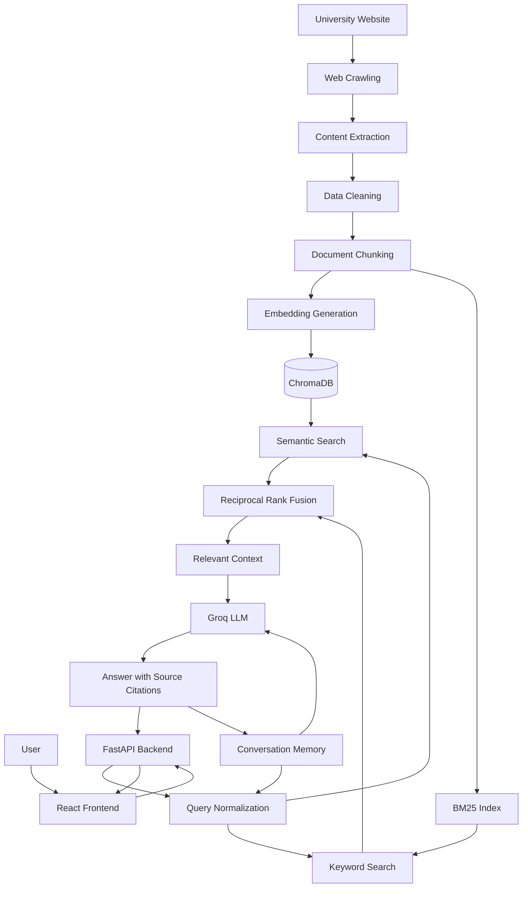

# 🎓 Shivalik AI — Intelligent University Assistant

Shivalik AI is an AI-powered conversational assistant designed to help students, parents, and prospective applicants access university-related information through natural language conversations.

Built using Retrieval-Augmented Generation (RAG), the system retrieves relevant information from publicly available university website content and generates context-aware responses with source citations.

The project aims to simplify information discovery, improve the digital student experience, and reduce repetitive university-related enquiries.

---

## 🚀 Key Features

- **Intelligent Question Answering:** Answers queries related to admissions, courses, eligibility, fees, placements, and campus facilities.
- **Hybrid RAG Architecture:** Combines semantic vector search and BM25 keyword-based retrieval.
- **Reciprocal Rank Fusion (RRF):** Combines retrieval rankings to improve document selection.
- **Multilingual Support:** Understands English, Hindi, and Hinglish queries.
- **Conversational Memory:** Supports contextual follow-up questions within a conversation.
- **Query Normalization:** Converts informal and multilingual queries into optimized standalone retrieval queries.
- **Source Citations:** Provides references to university website pages.
- **Automated Data Ingestion:** Crawls, extracts, cleans, and processes university website content.
- **Interactive User Interface:** Modern and responsive React-based chat interface.
- **REST API:** FastAPI backend for frontend and external application integration.

---

## 🏗️ System Architecture



---

## ⚙️ Technology Stack

| Category | Technologies |
|---|---|
| Programming Language | Python, JavaScript |
| Backend | FastAPI, Uvicorn |
| Frontend | React, Vite, Tailwind CSS |
| Generative AI | Groq, Llama 3.3 70B |
| RAG Framework | LangChain |
| Embedding Model | all-MiniLM-L6-v2 |
| Vector Database | ChromaDB |
| Keyword Retrieval | BM25 |
| Rank Fusion | Reciprocal Rank Fusion |
| Web Scraping | Requests, BeautifulSoup |
| Conversation Management | Session-based In-memory Storage |
| Version Control | Git, GitHub |

---

## 📂 Project Structure

```text
shivalik-ai/
│
├── app/
│   ├── api/
│   │   └── main.py
│   │
│   ├── ingestion/
│   │   ├── crawler.py
│   │   ├── extractor.py
│   │   ├── cleaner.py
│   │   └── loader.py
│   │
│   ├── rag/
│   │   ├── chunker.py
│   │   ├── embeddings.py
│   │   ├── vectorstore.py
│   │   ├── retriever.py
│   │   ├── query_normalizer.py
│   │   └── structured_data.py
│   │
│   └── services/
│       ├── chat.py
│       └── conversation_manager.py
│
├── data/
│   ├── raw/
│   ├── processed/
│   └── chroma_db/
│
├── frontend/
│   ├── public/
│   ├── src/
│   │   ├── assets/
│   │   ├── services/
│   │   │   └── api.js
│   │   ├── App.jsx
│   │   ├── App.css
│   │   ├── index.css
│   │   └── main.jsx
│   ├── package.json
│   └── vite.config.js
│
├── scripts/
│   ├── download_pdfs.py
│   ├── evaluate_retrieval.py
│   ├── inspect_chunks.py
│   ├── inspect_documents.py
│   ├── inspect_html.py
│   ├── list_pdf_links.py
│   └── validate_data.py
│
├── tests/
├── .env.example
├── .gitignore
├── requirements.txt
└── README.md
```

---

## 🧠 How It Works

### 1. Data Collection and Preprocessing

The ingestion pipeline collects publicly available university
website content, extracts relevant information, removes
unnecessary content, and prepares structured documents.

### 2. Document Chunking and Embeddings

Processed documents are divided into smaller chunks.
Each chunk is converted into a dense vector representation
using the `all-MiniLM-L6-v2` embedding model.

The embeddings are stored in ChromaDB for semantic retrieval.

### 3. Query Normalization

User queries are normalized into retrieval-friendly English
queries. The system also uses conversation history to resolve
ambiguous follow-up questions.

### 4. Hybrid Retrieval

The retrieval pipeline combines:

- Dense semantic retrieval using ChromaDB.
- Sparse keyword retrieval using BM25.
- Reciprocal Rank Fusion to combine retrieval rankings.
- Category-based relevance boosting.

This approach captures both semantic meaning and exact
keyword matches.

### 5. Response Generation

Relevant documents are passed to the LLM as context.
The model generates responses grounded in the retrieved
information and includes source citations.

### 6. Conversation Management

Each conversation is associated with a unique session ID,
allowing the assistant to understand contextual follow-up
questions without requiring users to repeat information.

---

## 💬 Example Queries

- What courses are offered by Shivalik University?
- What is the eligibility for B.Tech CSE Data Science?
- What is the fee structure for B.Tech?
- Tell me about placement opportunities.
- What facilities are available on campus?
- College mein admission kaise le sakte hain?
- Hostel facilities available hain kya?

### Multi-Turn Conversation Example

**User:** What is the eligibility for B.Tech CSE Data Science?

**Assistant:** Provides the eligibility requirements based on
the retrieved university information, along with source citations.

**User:** Agar mere 55% hain toh?

**Assistant:** Understands that the follow-up question refers
to the previously discussed programme and evaluates the
eligibility based on the retrieved requirements.

---

## 🛠️ Installation and Setup

### Prerequisites

- Python 3.10 or above
- Node.js and npm
- Git
- Groq API key

### 1. Clone the Repository

```bash
git clone https://github.com/heyyveer/Shivalik-AI.git
cd Shivalik-AI
```

### 2. Create a Virtual Environment

```bash
python -m venv venv
```

Activate on Windows:

```powershell
.\venv\Scripts\Activate.ps1
```

Activate on Linux/macOS:

```bash
source venv/bin/activate
```

### 3. Install Backend Dependencies

```bash
pip install -r requirements.txt
```

### 4. Configure Environment Variables

Create a `.env` file using `.env.example` as a reference.

```env
GROQ_API_KEY=your_groq_api_key
```

Never commit API keys or credentials to version control.

### 5. Prepare the Knowledge Base

Run the data ingestion pipeline in the following order:

1. Crawl the university website.
2. Extract and clean website content.
3. Load processed documents.
4. Generate document chunks.
5. Generate embeddings.
6. Populate the ChromaDB vector database.

The generated data and vector database are excluded from
version control and must be rebuilt during initial setup.

### 6. Start the Backend

```bash
python -m uvicorn app.api.main:app --reload
```

Backend:

```text
http://127.0.0.1:8000
```

Swagger API documentation:

```text
http://127.0.0.1:8000/docs
```

### 7. Install Frontend Dependencies

Open a separate terminal:

```bash
cd frontend
npm install
```

### 8. Start the Frontend

```bash
npm run dev
```

Open the application at:

```text
http://localhost:5173
```

---

## 🔌 API Reference

### Chat Endpoint

```http
POST /chat
```

### Request Body

```json
{
  "question": "What courses are available?",
  "conversation_id": null
}
```

### Response Structure

```json
{
  "answer": "Generated answer based on retrieved information.",
  "sources": [],
  "retrieved_chunks": 5,
  "conversation_id": "generated-session-id"
}
```

For follow-up questions, pass the conversation ID returned
by the previous response.

---

## 🎯 Project Objectives

- Simplify access to university-related information.
- Improve the digital experience for prospective students.
- Reduce repetitive admission-related enquiries.
- Enable multilingual information accessibility.
- Provide transparent, source-grounded AI responses.
- Explore practical applications of Generative AI in education.

---

## 🔮 Future Enhancements

- Official university website integration.
- Persistent conversation storage.
- Admin dashboard and query analytics.
- Automated knowledge base updates.
- Advanced RAG evaluation and benchmarking.
- Semantic caching and response latency optimization.
- API rate limiting and security hardening.
- Voice-based interaction.
- Human support escalation for unanswered queries.
- Docker-based deployment and monitoring.

---

## ⚠️ Limitations

- Answer quality depends on the availability and accuracy
  of the retrieved website content.
- University information may change over time.
- Conversation sessions are currently stored in memory
  and reset when the backend restarts.
- The system is a working prototype and requires further
  evaluation before production use.

---

## 👨‍💻 Author

**Veer Tiwari**

B.Tech Computer Science and Engineering (Data Science)

Shivalik College of Engineering

- GitHub: [heyyveer](https://github.com/heyyveer)
- LinkedIn: [heyveer](https://www.linkedin.com/in/heyveer/)

---

## 📌 Disclaimer

Shivalik AI is an independently developed project based on
publicly available university website information.

It is not currently an official university service.
Users should verify critical information related to admissions,
fees, eligibility, and university policies through official
university channels.

---

⭐ If you find this project useful, consider starring the repository.

**Built with Python, Generative AI, and a vision to make
university information more accessible.**
